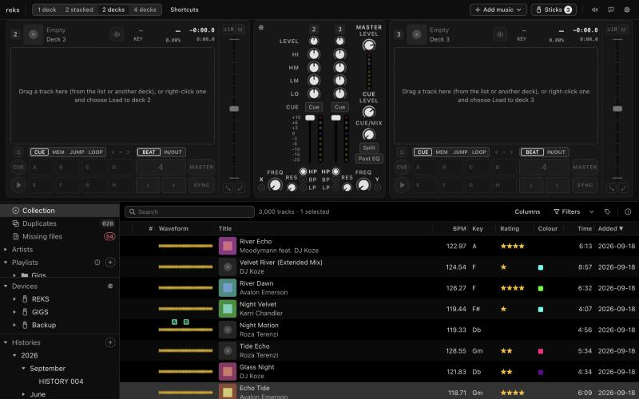

# reks

**A free, open-source DJ library app.**
Organise your music, analyse it, prep your sets, and export USB sticks for
Pioneer DJ / AlphaTheta players.

> [!WARNING]
> **Pre-alpha. No USB export has been tested on a real CDJ yet.**
> Don't take a reks stick to a gig without a backup stick made another way.

## What it does

- **Free, with nothing paywalled.** No subscription, no account, no paid
  plan. Open source (GPL). Runs on macOS, Windows and Linux.
- **Your own library.** Scan folders or drag in files; tags, artwork,
  playlists, a fast searchable and filterable track table, and smart playlists
  with nested rules (any / all / not, groups inside groups).
- **Brings your rekordbox collection along.** Beatgrids, cues, loops, keys,
  playlists, My Tags and play history, straight from rekordbox 6/7 on the same
  computer or from `collection.xml`.
- **Its own analysis.** BPM, beatgrid, key and every Pioneer waveform type.
- **USB export** in both rekordbox formats (legacy `export.pdb` and the newer
  Device Library Plus). Every write starts with a dry run showing exactly which
  files will be copied, written or deleted, and reks reads the stick back
  afterwards to check it.
- **Free stick backups.** The stick's database is backed up before every
  write. rekordbox's Device Library Backup needs the Professional plan.
- **Check any stick before a gig.** A read-only report on a stick, whoever made
  it: missing audio or analysis files, tracks without a waveform preview, files
  a player may reject, playlists that differ between the stick's two formats.
- **Stick profiles and play history.** Saved playlist sets per stick, and play
  history read back from played sticks. Mark a session as practice and it stays
  out of your play counts.
- **Mix-prep.** Up to 4 beat-synced decks with hot cues, loops and scrolling
  waveforms through a 4-channel mixer with EQ, filters and headphone cue.
- **Finds moved tracks by their content**, not their file name, and can point a
  whole music folder at its new location in one step.
- **Discogs lookup** for artist, title, label, year, genre and artwork, with
  every change shown for review before it's saved.
- **Housekeeping.** Converts lossless files to WAV, AIFF or FLAC and backs up
  your library automatically.
- **Your library is yours.** A plain, unencrypted SQLite file you can open
  with any tool, and rekordbox XML in and out, so there's no lock-in.
- **No telemetry.** Nothing leaves your computer unless you send a report.

## Download

Grab the file for your system from the
**[latest release](https://github.com/ninoman/reks-releases/releases/latest)**:

| System | File |
| --- | --- |
| macOS, Apple Silicon | `reks_<version>_aarch64.dmg` |
| macOS, Intel | `reks_<version>_x64.dmg` |
| Windows 10/11 | `reks_<version>_x64-setup.exe` |
| Linux | `reks_<version>_amd64.AppImage` or `.deb` |

Once installed, reks offers new versions itself (Settings → About to check by
hand). Ignore the `.sig`, `.tar.gz` and `latest.json` files; the updater uses
them.

### First launch

Builds are not code-signed yet, so your OS will warn the first time.

- **macOS:** open the app once, close the warning, then go to
  System Settings → Privacy & Security and click **Open Anyway**.
- **Windows:** on the SmartScreen prompt click **More info → Run anyway**.
- **Linux:** `chmod +x reks_*.AppImage` and run it, or install the `.deb`.

## Feedback

Found a bug or a stick that won't load? Use **Report a problem or idea** (the
speech bubble in the app header; it sends only what the dialog shows, and
there's no telemetry), or
[open an issue](https://github.com/ninoman/reks-releases/issues).

## Licence

reks is free software under the GPL-3.0-or-later. It is donation-funded, with no
paid tiers.

Not affiliated with or endorsed by AlphaTheta / Pioneer DJ, inMusic / Denon DJ
or any other manufacturer. rekordbox, CDJ, XDJ and Engine DJ are trademarks of
their respective owners.
